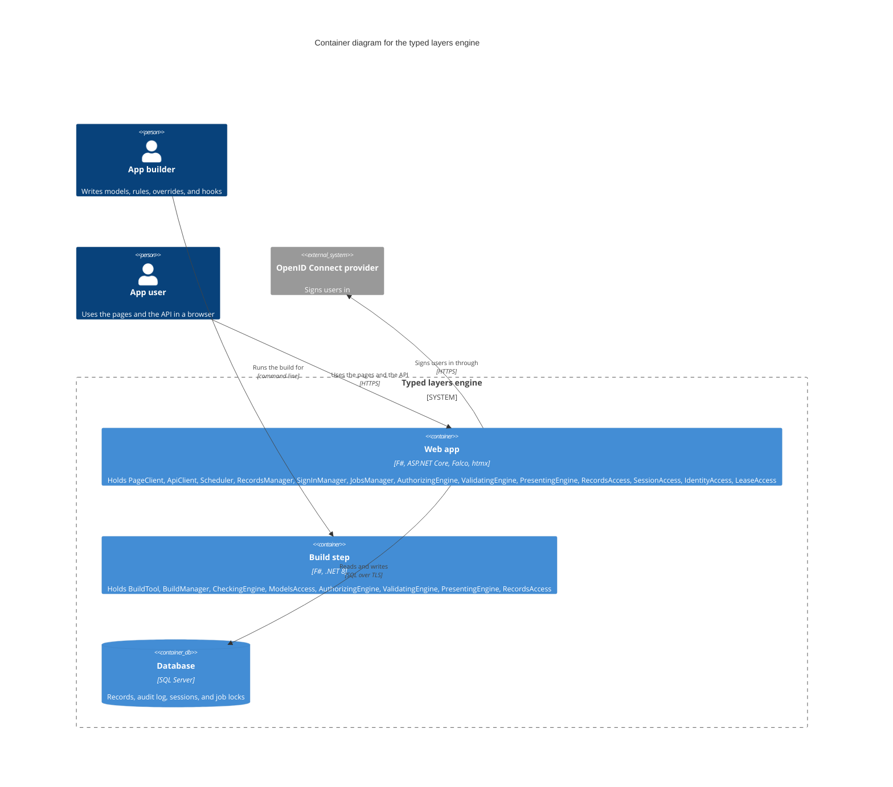
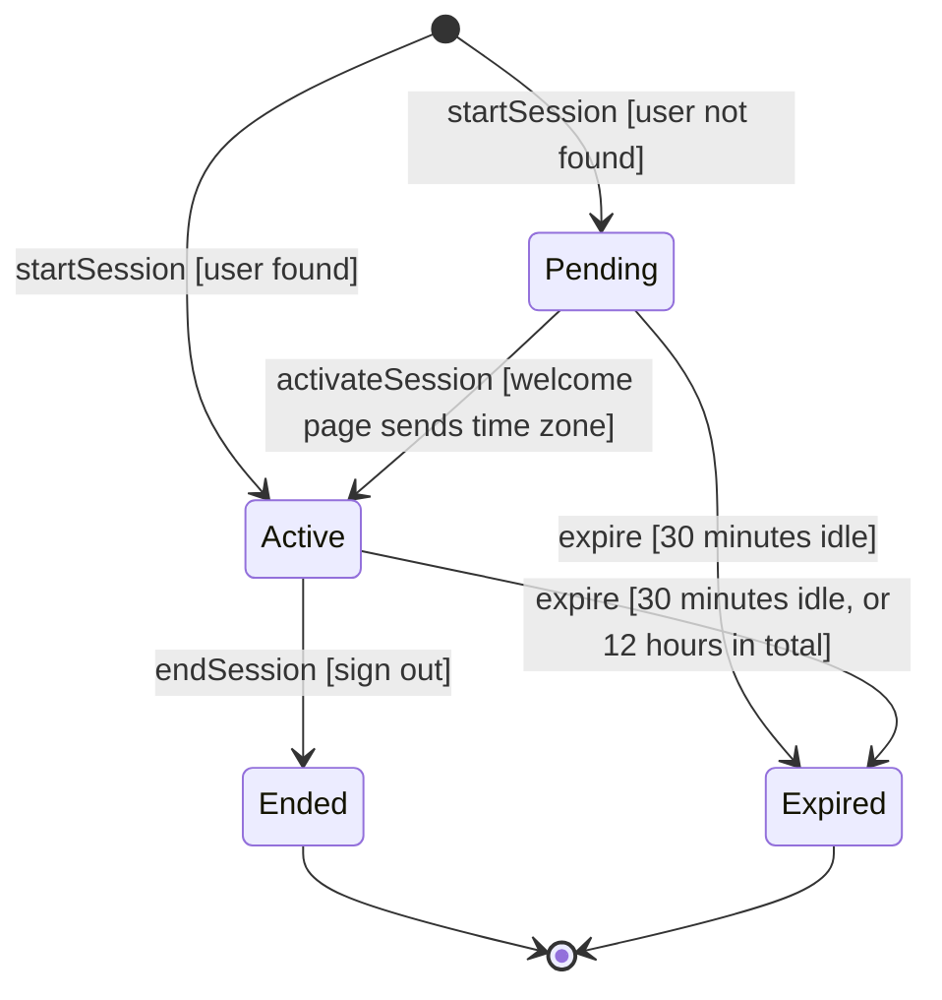
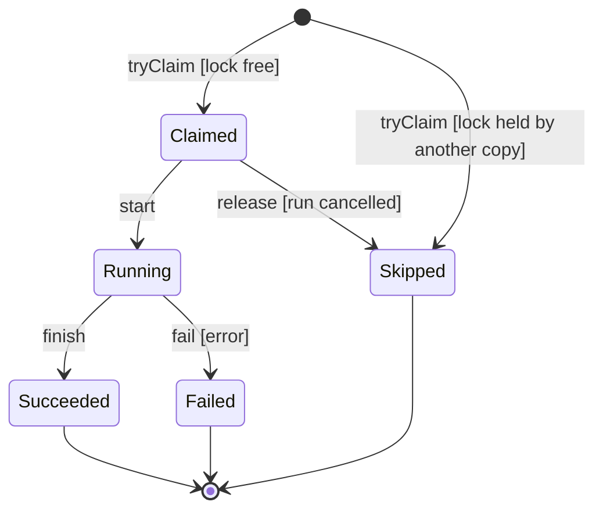
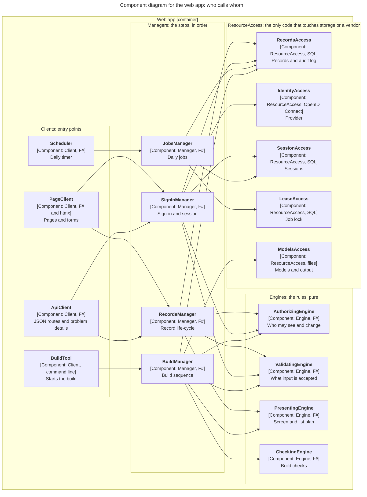

# Typed layers engine: Agent System Design Document

**Source design:** `typed-layers-engine.md` · **Language:** F# on .NET 8 · **Status:** draft

## 1. Header & boundary box: what gets built, and what does not

**System:** A typed-model engine that turns F# record types into a secure, server-rendered web app with access control, storage, validation, screens, and a JSON API. The todo list app is its first test.
**Target mode:** A modular monolith in F#, ASP.NET Core with Falco, htmx, SQL Server *(assumed: the design did not pick a deployment; one app is the simplest shape)*

Everything runs in two containers and one build step. The build step is part of the same solution.



Key: the blue boxes run inside the system. The grey box is another system. Each container lists the components that it holds in section 5.

### In scope

- Build checks that fail the build when a model, rule, or override is missing or wrong.
- Field behaviour from the field type and name: override, then type default, then kind default.
- One access rule for each model: `owned`, `ownedVia`, `self`, and `system`. Read-only conditions on owned and child records.
- Storage: tables, derived indexes, keyset paging, child deletes in the same transaction, and migrations.
- One validation rule set for pages and for the API.
- Server-rendered lists and forms, with htmx, list views, and a History tab.
- A JSON API under the same session, with RFC 9457 problem details.
- Hooks: before save, after save, computed value, and delete check.
- An audit log with masking of `sensitive` fields.
- Sign-in with an OpenID Connect provider, sessions, sign-out, and the user record on first sign-in.
- Security baseline: headers, anti-forgery tokens, rate limits, and request size caps.
- Two daily jobs, each run once across many copies of the app.
- The todo app, built only from models, access rules, overrides, and two hooks.

### Out of scope (non-goals)

- API access for other apps, such as a phone app.
- Users deleting their own account.
- Sharing lists between users, and roles beyond the owner.
- Sorting and filtering lists beyond the named list views.
- Real-time updates between browsers.
- Page layouts beyond the list and the form.
- Soft delete and restore.
- A separate front end, such as a single-page app.
- Lists as a field kind. This comes later, with the tags test.

### Decisions carried from the design

- The language is F# on .NET. Storage is SQL Server. Pages use server-rendered HTML with htmx.
- Sign-in uses an external OpenID Connect provider. The API serves only this app's own pages, with the same session.
- Each owned model carries its own `Owner` field. Deleting a parent deletes its children. Archiving is the soft option.
- API errors use RFC 9457 problem details, with the errors listed for each field.
- Engines are pure. The Manager passes in the data that they need.
- `Version` is sent back with each save, and only catches stale saves.

### Decisions added by this spec

Each item was open in the design. This spec decides it. Review these first.

- Deployment: one app container with one database. *(assumed)* If wrong: split the components into services. The walls stay the same.
- Sign-in flow: OpenID Connect authorization code with PKCE. *(assumed)* If wrong: change `IdentityAccess` only.
- Session ids: 256 random bits, base64url. The session cookie uses HttpOnly, Secure, and SameSite=Lax, as the design requires. *(assumed)* If wrong: change `SessionAccess` only.
- Pending sessions end after 30 minutes idle. *(assumed)* If wrong: change one constant in `SessionAccess`.
- Job lock lease: 15 minutes, with no renewal. *(assumed)* If wrong: a job that runs longer than 15 minutes can run twice. Change the constant, or add renewal.
- Ids: a UUID v7 wrapped in one single-case type for each model. *(assumed)* If wrong: a bare `Guid` would let code mix ids of different models.
- Time: `DateTimeOffset` in UTC at each boundary. Local time appears only in rules that need it, with an IANA time zone. *(assumed)* If wrong: change the boundary parsing in `ValidatingEngine`.
- Writes are never retried by the app. A repeated create makes a second record. *(assumed)* If wrong: add an idempotency key to `create`, and store the first result for each key.
- Reads may retry once on a dependency timeout. *(assumed)* If wrong: remove the retry. Each call still has its timeout.
- Each database command has a 5-second timeout, as the design requires. *(assumed: the spec gives the number; the retry rule is new.)*
- Errors cross component boundaries as `Result` values. Only the outer request handler turns an unexpected exception into `UNEXPECTED_ERROR`, and logs it with a reference id. *(assumed)* If wrong: unexpected exceptions reach the user as a 500 page.
- `Scope` has a private constructor. Only `AuthorizingEngine` builds it. *(assumed how the seal works)* If wrong: any code can make a scope, and deny by default is lost.
- Build-time `RecordsAccess` verbs (`planStorage` and `wire`) take the engine-only scope that `AuthorizingEngine` makes. *(assumed)* If wrong: the build cannot read records, which is intended.
- Code folders use the spec's names: Generator, Access, Validate, Persist, Display, Api, Runtime. The design's component names stay inside those folders. *(assumed)* The map is in `pdlc/specs/design/DES-names.md`. If wrong: rename the folders. The walls do not move.
- The checks use SQLite in memory as a test double. Checks that need SQL Server run only in CI, and carry a `RequiresSqlServer` marker. *(assumed)* The rule is in `pdlc/specs/design/DES-test-database.md`. If wrong: the paging checks would run only in CI.

### Words used here

- **Invariant**: a rule that must always be true, in all conditions.
- **Idempotent**: safe to do two times. The second time changes nothing.
- **Scope**: a value that limits which records a query can see. Only `AuthorizingEngine` makes one.
- **Sealed**: a type that only one module can create. Other code can read it but not build it.
- **Keyset paging**: a page is found from the last row of the previous page, not from a row count.
- **Lease**: a lock with an end time. A copy of the app holds a job until the lease ends or is released.
- **Anti-forgery token**: a value in each form that proves the form came from this app.
- **Problem details**: the RFC 9457 format for an error response. It has a `type`, a `title`, a `status`, and a `code`.
- **Compare-and-set**: a write that succeeds only if the stored value is still the value that the caller read.
- **Encapsulates**: keeps one likely change inside one part, so the change does not touch other parts.

## 2. System invariants: rules that must always hold

1. **Access is denied by default.** Every record query takes a `Scope`. A record outside the scope is treated as absent. Enforced by `RecordsAccess.find`, and by every other `RecordsAccess` verb. Violation: `NOT_FOUND`.
2. **A stale save never overwrites a newer record.** A save sends the `Version` it read. The save writes only if the stored `Version` is the same, in the same transaction as the write and its audit entry. Enforced by `RecordsAccess.revise`. Violation: `STALE_VERSION`.
3. **A read-only record cannot change.** A user edit or delete of a read-only record is refused, with the reason. Enforced by `RecordsManager.change` and `RecordsManager.remove`, after `AuthorizingEngine.checkChange`. Violation: `READ_ONLY_RECORD`.
4. **Input that breaks a rule is never saved.** Pages and the API use the same rules. Enforced by `ValidatingEngine.accept`, before any write. Violation: `VALIDATION_FAILED`.
5. **A model without an access rule, or with a broken link, does not build.** Enforced by `CheckingEngine.check`, before any code is written. Violation: `MISSING_ACCESS_RULE` or `DANGLING_REFERENCE`.
6. **A session moves only along the drawn transitions.** Enforced by `SessionAccess.activateSession` and `SessionAccess.endSession`, as compare-and-set writes. Violation: `INVALID_SESSION_TRANSITION`.

## 3. Core domain data contracts: the exact shape of the data

Conventions:

- Each id is its own single-case type. Code cannot pass a `UserId` where a `RecordId` is expected.
- Times are `DateTimeOffset` values in UTC.
- Option types (`option`) mark a field that can be missing.
- Errors are values: `Result<'T, ErrorDetail>`.

```fsharp
module Contracts

open System

type UserId = UserId of Guid
type RecordId = RecordId of Guid
type SessionId = SessionId of string
type Version = Version of int64
type ModelName = ModelName of string

type ErrorCode =
    | NOT_FOUND
    | STALE_VERSION
    | READ_ONLY_RECORD
    | VALIDATION_FAILED
    | INVALID_SESSION_TRANSITION
    | ANTI_FORGERY_FAILED
    | REQUEST_TOO_LARGE
    | RATE_LIMITED
    | SESSION_EXPIRED
    | LEASE_HELD
    | DEPENDENCY_UNAVAILABLE
    | UNEXPECTED_ERROR
    | MISSING_ACCESS_RULE
    | MISSING_DEFAULT
    | MISSING_FIELD
    | WRONG_CONFIG_TYPE
    | SYSTEM_FIELD_TARGET
    | DANGLING_REFERENCE
    | NO_TITLE_FIELD
    | UNPLANNED_DROP

type ErrorDetail =
    { Code: ErrorCode
      Reason: string option
      Fields: (string * string) list
      ReferenceId: Guid option }

/// Only AuthorizingEngine builds a Scope. A private constructor enforces this.
type Scope =
    private
    | OwnerOnly of UserId
    | EngineOnly

type Principal =
    { User: UserId
      Session: SessionId
      TimeZone: TimeZoneInfo }

/// Raw input from a form or the API, before validation.
type Candidate =
    { Model: ModelName
      Values: Map<string, string>
      Version: Version option }

type Severity =
    | Error
    | Warning

type Finding =
    { Severity: Severity
      Code: ErrorCode
      Model: ModelName
      Field: string option
      Message: string }

type SessionState =
    | Pending of since: DateTimeOffset
    | Active of user: UserId * lastSeen: DateTimeOffset
    | Ended of at: DateTimeOffset
    | Expired of at: DateTimeOffset

type JobRun =
    | Claimed
    | Running
    | Succeeded
    | Failed of reason: string
    | Skipped
```

### Error catalog

One row for each code in `ErrorCode`. The fault column names who must act. A caller fault is a 4xx. A supplier fault is a 5xx. Over HTTP, each error travels as RFC 9457 problem details (`application/problem+json`), with the code in a `code` member. The build codes have no HTTP status, because they stop the build before any request runs.

| Code | Meaning | Fault | HTTP | Retry helps? |
|------|---------|-------|------|--------------|
| `NOT_FOUND` | The record does not exist, or is outside the caller's scope | caller | 404 | no |
| `STALE_VERSION` | The save used an old `Version` | caller | 409 | no: reload, then save again |
| `READ_ONLY_RECORD` | The record is read-only. The reason is in the response | caller | 409 | no |
| `VALIDATION_FAILED` | An input broke a rule. Field errors are listed | caller | 422 | no |
| `INVALID_SESSION_TRANSITION` | A session move is not drawn in section 4 | supplier | 500 | no |
| `ANTI_FORGERY_FAILED` | The form or API call has no valid anti-forgery token | caller | 403 | no |
| `REQUEST_TOO_LARGE` | The request body is over 1 MB | caller | 413 | no |
| `RATE_LIMITED` | Over 120 requests a minute for a user, or 10 provider returns a minute for an address | caller | 429 | yes, after `Retry-After` |
| `SESSION_EXPIRED` | The session ended, or was idle for 30 minutes | caller | 401 | no: sign in again |
| `LEASE_HELD` | Another copy of the app holds the job lock. The job is skipped | supplier | none | yes, at the next daily run |
| `DEPENDENCY_UNAVAILABLE` | The database or the provider timed out | supplier | 503 | yes, with backoff |
| `UNEXPECTED_ERROR` | An unexpected fault. The response has a generic message and a reference id | supplier | 500 | no |
| `MISSING_ACCESS_RULE` | A model has no access rule | caller (app builder) | none | no: fix the models |
| `MISSING_DEFAULT` | A type has no default in an engine | caller (app builder) | none | no: add the default |
| `MISSING_FIELD` | An override names a field that does not exist | caller (app builder) | none | no |
| `WRONG_CONFIG_TYPE` | An override's config does not fit the field type | caller (app builder) | none | no |
| `SYSTEM_FIELD_TARGET` | An override targets a system field | caller (app builder) | none | no |
| `DANGLING_REFERENCE` | A reference points at a model that does not exist | caller (app builder) | none | no |
| `NO_TITLE_FIELD` | A referenced model has no title field | caller (app builder) | none | no |
| `UNPLANNED_DROP` | A migration drops a column with no `renamedFrom` | caller (app builder) | none | no |

## 4. State machines: how things move from one state to the next

### SessionState



Stored by `SessionAccess`. The verb on each arrow does that transition as a compare-and-set. The system refuses each transition that is not drawn, with `INVALID_SESSION_TRANSITION`. Terminal states: `Ended` and `Expired`.

### JobRun



Stored by `LeaseAccess`. `tryClaim` is the only verb that moves a job out of no state. Terminal states: `Succeeded`, `Failed`, and `Skipped`. A failed run calls `Alerting`.

## 5. Module boundaries & interface signatures: the parts and how to call them

### Module map

Folders use the spec's names, as `pdlc/specs/design/DES-names.md` decides. Each folder holds the components that the table in that file maps to it. The components below keep the design's names, so that the design and this blueprint can be checked against each other.

```
src/
  Typed.Engine/
    Contracts.fs              types from section 3
    Model.fs                  ModelCore: kinds, defaults, field plans (no dependencies)
    Generator/                BuildTool, BuildManager, CheckingEngine, ModelsAccess
    Access/                   AuthorizingEngine
    Validate/                 ValidatingEngine
    Persist/                  RecordsAccess
    Display/                  PresentingEngine, PageClient
    Api/                      ApiClient
    Runtime/                  RecordsManager, SignInManager, JobsManager, Scheduler,
                              SessionAccess, IdentityAccess, LeaseAccess
    Utilities/                Logging, Alerting, Settings, WebGuard, Clock
  Todo.App/
    Models.fs                 the todo models, access rules, overrides, and hooks
tests/
  Typed.Engine.Tests/         the scenarios from section 6, as xUnit checks
```

`ModelCore` is not a component. It holds the stable parts that all components share: the kind list, the field plans, and the one-time lookup "override, then type default, then kind default." It depends on nothing.

### Component diagram

The design's components inside the web app container, with the technology of each one. Arrows show calls. Utilities are left off the arrows, because any component may use them.



Key: each band is one layer. A box calls only the boxes that an arrow leads to. All arrows point down the layers.

### Shared infrastructure (Utilities)

- **Logging**: writes structured log lines. Drops `sensitive` field values. May call nothing.
- **Alerting**: raises an alert when a job fails, or when access denials or server errors reach 5 times the usual hourly rate. May call `Logging`.
- **Settings**: reads the app settings: page sizes, session times, rate limits, size caps. May call nothing.
- **WebGuard**: sets the security headers, checks anti-forgery tokens, and applies the rate limits and size caps. May call `Settings` and `Logging`.
- **Clock**: returns the current time. Tests replace it. May call nothing.

### Entry points (Clients)

#### PageClient

- **Purpose:** Turns browser requests into calls to the managers, and turns results into HTML.
- **Encapsulates:** Pages, forms, htmx row swaps, and HTML encoding. It also owns the welcome-page script that sends the browser's time zone.
- **Constraints:** Callers prove who they are with the session cookie from the sign-in. Each form that changes data carries an anti-forgery token, checked by `WebGuard`. No business rules.
- **May call:** `RecordsManager`, `SignInManager`, `WebGuard`, `Logging`.

```fsharp
let routes : (string * string) list      // method and path, from the models
let handle (request: HttpRequest) : Async<HttpResponse>
```

- **Failure & retry:** Each `ErrorCode` maps to its page: `NOT_FOUND` to a 404 page, `VALIDATION_FAILED` to the same form with the field errors, `SESSION_EXPIRED` to the sign-in page. The browser may retry a GET. The app never retries a POST.
- **Internals:** `RouteTable`, `FormReader`, `RenderScreen`, `WelcomeZoneScript`

#### ApiClient

- **Purpose:** Serves the same routes as JSON under `/api`.
- **Encapsulates:** JSON routes, the wire format, and the problem-details format.
- **Constraints:** Same session and anti-forgery rules as `PageClient`. Requests above 1 MB are refused before parsing. No business rules.
- **May call:** `RecordsManager`, `SignInManager`, `WebGuard`, `Logging`.

```fsharp
let routes : (string * string) list      // the same routes as PageClient, under /api
let handle (request: HttpRequest) : Async<HttpResponse>
```

- **Failure & retry:** Each error becomes an RFC 9457 problem with its `code`. Field errors go in an `errors` list. Clients may retry only the codes that the error catalog marks as retryable, and after `Retry-After`.
- **Internals:** `RouteTable`, `JsonReader`, `WireCodec`, `ProblemDetails`

#### Scheduler

- **Purpose:** Starts the daily jobs once each day.
- **Encapsulates:** The daily timer. Each copy of the app starts its own timer, with jitter, so the copies do not all start at once.
- **Constraints:** Holds no state. Each job is decided by `JobsManager`.
- **May call:** `JobsManager`, `Clock`, `Logging`.

```fsharp
let onDaily (now: DateTimeOffset) : Async<unit>
```

- **Failure & retry:** A failed run is logged and alerted by `JobsManager`. The timer does not retry. The next daily run tries again.
- **Internals:** none. A timer only.

#### BuildTool

- **Purpose:** The command that CI and app builders run.
- **Encapsulates:** The command line and its exit codes.
- **Constraints:** Any builder can run it. A signed build proves where it came from. *(assumed: builds are signed by the CI system, as the design requires)*
- **May call:** `BuildManager`.

```fsharp
let generate (models: string list) : Async<int>   // exit code: 0 for success, 1 for findings with errors
```

- **Failure & retry:** Prints each `Finding` with its code. Exit 1 when any error finding exists. Warnings do not fail the build.
- **Internals:** none. A command line only.

### Orchestration (Managers)

#### RecordsManager

- **Purpose:** Runs the steps to create, change, delete, list, and show a record.
- **Encapsulates:** The record life-cycle: the order of checks, the hooks, and the audit writes.
- **Constraints:** Runs the steps in order. No business rules: rules come from the engines and the hooks.
- **May call:** `AuthorizingEngine`, `ValidatingEngine`, `PresentingEngine`, `RecordsAccess`, `Clock`, `Logging`.

```fsharp
let list (principal: Principal) (model: ModelName) (view: string option) (after: string option) : Async<Result<ListPage, ErrorDetail>>
let openForm (principal: Principal) (model: ModelName) (id: RecordId option) : Async<Result<ScreenPlan, ErrorDetail>>
let show (principal: Principal) (model: ModelName) (id: RecordId) : Async<Result<Record, ErrorDetail>>
let create (principal: Principal) (candidate: Candidate) : Async<Result<Record, ErrorDetail>>
let change (principal: Principal) (id: RecordId) (candidate: Candidate) : Async<Result<Record, ErrorDetail>>
let remove (principal: Principal) (id: RecordId) : Async<Result<unit, ErrorDetail>>
let history (principal: Principal) (id: RecordId) : Async<Result<AuditEntry list, ErrorDetail>>
```

- **Flow of `create`:**
  1. The caller passes the `Principal`, which `PageClient` or `ApiClient` gets from the session.
  2. `RecordsAccess.find` the parent record, in the caller's scope. `NOT_FOUND` if it is not visible.
  3. `AuthorizingEngine.checkChange` on the parent. `READ_ONLY_RECORD` if it is archived.
  4. `AuthorizingEngine.ownerFor` the new record. This copies the parent's owner for `ownedVia`.
  5. `ValidatingEngine.accept` the candidate, with a `Visible` lookup bound to `RecordsAccess.findVisible`. `VALIDATION_FAILED` on any error.
  6. Run the before-save hook through `HookRunner`.
  7. `RecordsAccess.add`, which inserts the row and its audit entry in one transaction.
  8. Run the after-save hook after the commit. A failure is logged. It never undoes the save.
- **Flow of `change`:** Same as `create`, with `RecordsAccess.revise` in step 7. `STALE_VERSION` if the `Version` does not match. `READ_ONLY_RECORD` is checked before validation.
- **Flow of `remove`:** `RecordsAccess.find`, then `AuthorizingEngine.checkChange`, then the delete check hook, then `RecordsAccess.remove`. That verb deletes the children, one audit entry for each, in the same transaction.
- **Failure & retry:** In-process. Errors are returned as values. A write is never retried. Each database call has a 5-second timeout. A timeout returns `DEPENDENCY_UNAVAILABLE`, and the transaction rolls back. The user retries by hand.
- **Internals:** `HookRunner`

#### SignInManager

- **Purpose:** Runs the steps to sign in, finish the welcome page, resume a session, and sign out.
- **Encapsulates:** The sign-in sequence. A second sign-in step would change this manager only.
- **Constraints:** Runs the steps in order. No business rules. Each state change goes through `SessionAccess`, and each one is a compare-and-set.
- **May call:** `IdentityAccess`, `SessionAccess`, `RecordsAccess`, `AuthorizingEngine`, `ValidatingEngine`, `Clock`, `Logging`.

```fsharp
let beginSignIn (returnTo: string) : Async<Result<Uri, ErrorDetail>>
let completeSignIn (code: string) (state: string) : Async<Result<SessionId, ErrorDetail>>
let finishWelcome (principal: Principal) (timeZone: string) : Async<Result<Principal, ErrorDetail>>
let resume (cookie: string) : Async<Result<Principal, ErrorDetail>>
let signOut (principal: Principal) : Async<Result<unit, ErrorDetail>>
```

- **Flow of `completeSignIn`:**
  1. `IdentityAccess.completeSignIn` exchanges the code for the provider's identity. `DEPENDENCY_UNAVAILABLE` on a timeout.
  2. `RecordsAccess.findBy` the identity's subject, with `AuthorizingEngine.scopeFor` the system scope.
  3. If the user exists: `SessionAccess.startSession` with state `Active`.
  4. If not: `SessionAccess.startSession` with state `Pending`. The welcome page then posts the time zone.
- **Flow of `finishWelcome`:** `ValidatingEngine.accept` the time zone, then `RecordsAccess.add` the user, then `SessionAccess.activateSession`. The three steps run in one transaction.
- **Failure & retry:** A failed provider exchange is final. The user signs in again. `RATE_LIMITED` applies to provider returns, as the spec requires.
- **Internals:** `SessionState`

#### JobsManager

- **Purpose:** Runs each daily job once, across all copies of the app.
- **Encapsulates:** The steps of a job: claim, run, log, and alert.
- **Constraints:** Runs the steps in order. No business rules: the rules are the retention days in `Settings`.
- **May call:** `LeaseAccess`, `RecordsAccess`, `SessionAccess`, `Alerting`, `Logging`, `Clock`.

```fsharp
let runDue (now: DateTimeOffset) : Async<JobRun list>
```

- **Flow of `runDue`:**
  1. For each job: `LeaseAccess.tryClaim`. On `LEASE_HELD`, record `Skipped` and go on to the next job.
  2. Purge audit entries older than 90 days, with `RecordsAccess.forgetOldHistory`.
  3. Purge expired sessions, with `SessionAccess.forgetExpiredSessions`.
  4. `LeaseAccess.release`. A failed run calls `Alerting`.
- **Failure & retry:** A failed job is recorded as `Failed` and alerted. It is not retried in the same run. The next daily run tries again. A lease that is not released ends by itself after 15 minutes.
- **Internals:** `JobRun`, `PurgeAudit`, `PurgeSessions`

#### BuildManager

- **Purpose:** Runs the build sequence: load the models, plan the wiring, check, and write.
- **Encapsulates:** The order of the build steps.
- **Constraints:** Runs the steps in order. No business rules: the checks are in `CheckingEngine`.
- **May call:** `ModelsAccess`, `AuthorizingEngine`, `ValidatingEngine`, `PresentingEngine`, `RecordsAccess`, `CheckingEngine`, `Logging`.

```fsharp
let generate (modelNames: string list) : Async<Result<BuildOutput, Finding list>>
```

- **Flow of `generate`:**
  1. `ModelsAccess.loadModels`, then `ModelsAccess.readLastShape`.
  2. `PresentingEngine.planList` for each model. This makes each `ListSpec`.
  3. `AuthorizingEngine.wire`, `ValidatingEngine.wire`, `PresentingEngine.wire`.
  4. `RecordsAccess.planStorage`, then `RecordsAccess.wire`. Both use the engine-only scope.
  5. `CheckingEngine.check`. It reads each engine's `covers` result.
  6. If there is no error: `ModelsAccess.writeGenerated`, then `ModelsAccess.storeShape`.
- **Failure & retry:** Errors are returned as `Finding` values. A build is not retried. A rerun gives the same result, because the steps are deterministic.
- **Internals:** none. The manager is wiring only.

### Business rules (Engines)

Engines are pure. They read no store, make no network call, and read no clock. The manager passes in what they need.

#### AuthorizingEngine

- **Purpose:** Decides who may see and change each record, and builds the `Scope` that `RecordsAccess` requires.
- **Encapsulates:** The access rule of each model, and the read-only conditions.
- **Constraints:** Pure. The only place that builds a `Scope`.
- **May call:** `Logging`.

```fsharp
let scopeFor (principal: Principal) (model: ModelName) : Scope
let ownerFor (principal: Principal) (model: ModelName) (parent: Record option) : UserId option
let checkChange (principal: Principal) (record: Record) (parent: Record option) : Result<unit, ErrorDetail>
let covers (model: ModelName) : Finding list
let wire (models: ModelPlan list) : Result<WiringPlan, Finding list>
```

- **Failure & retry:** Deterministic. Returns errors as values. No retries.
- **Internals:** `Owned`, `OwnedVia`, `SelfOnly`, `SystemOnly`, `ReadOnlyWhenParent`, `EmitWiring`

#### ValidatingEngine

- **Purpose:** Turns raw input into typed values, or into field errors. The same rules serve pages and the API.
- **Encapsulates:** The rule set for each type and kind, and the `rule` overrides.
- **Constraints:** Pure. Takes the reference lookup as a function parameter.
- **May call:** `Logging`.

```fsharp
let accept (model: ModelPlan) (candidate: Candidate) (visible: RecordId -> bool) : Result<TypedRecord, FieldErrors>
let covers (model: ModelName) : Finding list
let wire (models: ModelPlan list) : Result<WiringPlan, Finding list>
```

- **Failure & retry:** Deterministic. Returns errors as values. No retries.
- **Internals:** `TakeWritable`, `ParseField`, `CheckKind`, `CheckOverrideRule`, `CheckReference`, `GatherErrors`, `EmitWiring`

#### PresentingEngine

- **Purpose:** Plans what each screen shows: each label, control, column, and view.
- **Encapsulates:** Which control, label, column, and list view each field gets.
- **Constraints:** Pure. Reads limits from `TypeInfo`, not from `ValidatingEngine`.
- **May call:** `Logging`.

```fsharp
let planList (model: ModelPlan) : ListSpec
let planForm (model: ModelPlan) (route: RouteContext) : ScreenPlan
let covers (model: ModelName) : Finding list
let wire (models: ModelPlan list) : Result<WiringPlan, Finding list>
```

- **Failure & retry:** Deterministic. No retries.
- **Internals:** `LabelFromName`, `ControlFor`, `FormFields`, `ListColumns`, `ListOrder`, `ListViews`, `ListEdit`, `TitleOf`, `LimitsToAttributes`, `EmitWiring`

#### CheckingEngine

- **Purpose:** Decides which build findings fail the build, and which only warn.
- **Encapsulates:** The list of build checks. More checks are likely.
- **Constraints:** Pure. Each check is one brick. Adding a check adds one brick.
- **May call:** `Logging`.

```fsharp
let check (models: ModelPlan list) (previousShape: ShapeSnapshot option) : Finding list
```

- **Failure & retry:** Deterministic. Each finding names its code, model, and field.
- **Internals:** `MissingDefault`, `MissingAccessRule`, `MissingField`, `WrongConfigType`, `SystemFieldTarget`, `DanglingReference`, `NoTitleField`, `UnplannedDrop`, `RedundantOverride`, `ListUnsafe`

### Resource access (ResourceAccess)

#### RecordsAccess

- **Purpose:** Reads and writes records, their audit entries, and their schema, in SQL Server.
- **Encapsulates:** The database: tables, queries, indexes, migrations, and the audit log.
- **Constraints:** The only code that touches the records tables. Every verb takes a `Scope`, so a call without one does not compile. Exposes business verbs, not SQL.
- **May call:** `Settings`, `Clock`, `Logging`.

```fsharp
let find (scope: Scope) (id: RecordId) : Async<Result<Record, ErrorDetail>>
let findBy (scope: Scope) (field: string) (value: string) : Async<Result<Record option, ErrorDetail>>
let findVisible (scope: Scope) (model: ModelName) (id: RecordId) : Async<bool>
let page (scope: Scope) (spec: ListSpec) (after: KeysetCursor option) (size: int) : Async<Result<ListPage, ErrorDetail>>
let add (scope: Scope) (record: TypedRecord) (actor: UserId) : Async<Result<Record, ErrorDetail>>
let revise (scope: Scope) (id: RecordId) (version: Version) (record: TypedRecord) (actor: UserId) : Async<Result<Record, ErrorDetail>>
let remove (scope: Scope) (id: RecordId) (actor: UserId) : Async<Result<unit, ErrorDetail>>
let historyOf (scope: Scope) (id: RecordId) : Async<Result<AuditEntry list, ErrorDetail>>
let forgetOldHistory (scope: Scope) (olderThan: DateTimeOffset) : Async<Result<int, ErrorDetail>>
let planStorage (models: ModelPlan list) : Result<StoragePlan, Finding list>
let wire (models: ModelPlan list) : Result<WiringPlan, Finding list>
```

- **Failure & retry:** Each verb runs in one transaction. A timeout returns `DEPENDENCY_UNAVAILABLE` and rolls back. Reads may retry once after a short wait, as section 1 decides. Writes are never retried.
- **Internals:** `ColumnMap`, `QueryBuilder`, `KeysetCursor`, `IndexDeriver`, `MigrationDiffer`, `RecordTable`, `AuditTrail`, `SensitiveMask`, `EmitWiring`

#### SessionAccess

- **Purpose:** Stores sessions, and moves them between states.
- **Encapsulates:** Where sessions live. The design moves them to a cache later, with this component only.
- **Constraints:** Each move is a compare-and-set. Each move must be drawn in section 4.
- **May call:** `Settings`, `Clock`, `Logging`.

```fsharp
let startSession (user: UserId option) : Async<Result<SessionId, ErrorDetail>>
let activateSession (id: SessionId) (user: UserId) : Async<Result<unit, ErrorDetail>>
let resumeSession (id: SessionId) : Async<Result<Principal, ErrorDetail>>
let endSession (id: SessionId) : Async<Result<unit, ErrorDetail>>
let forgetExpiredSessions () : Async<Result<int, ErrorDetail>>
```

- **Failure & retry:** A move that does not match the stored state returns `INVALID_SESSION_TRANSITION`. Timeouts return `DEPENDENCY_UNAVAILABLE`. Reads may retry once. Writes are not retried.
- **Internals:** `SessionTable`

#### IdentityAccess

- **Purpose:** Talks to the sign-in provider.
- **Encapsulates:** The OpenID Connect provider.
- **Constraints:** The only code that calls the provider. Checks the signature and the state value on each return.
- **May call:** `Settings`, `Clock`, `Logging`.

```fsharp
let beginSignIn (returnTo: string) : Async<Result<Uri, ErrorDetail>>
let completeSignIn (code: string) (state: string) : Async<Result<ProviderIdentity, ErrorDetail>>
let endProviderSession (identity: ProviderIdentity) : Async<Result<unit, ErrorDetail>>
```

- **Failure & retry:** Timeout of 5 seconds per call. A timeout returns `DEPENDENCY_UNAVAILABLE`. A failed check returns `ANTI_FORGERY_FAILED`. No retries on the exchange, because the code is single-use.
- **Internals:** `OidcExchange`

#### LeaseAccess

- **Purpose:** Holds each job lock, so one copy of the app runs a job at a time.
- **Encapsulates:** The job lock method.
- **Constraints:** `tryClaim` is one atomic write. A lease ends after 15 minutes.
- **May call:** `Settings`, `Clock`, `Logging`.

```fsharp
let tryClaim (job: string) (now: DateTimeOffset) : Async<Result<unit, ErrorDetail>>
let release (job: string) : Async<Result<unit, ErrorDetail>>
```

- **Failure & retry:** A held lock returns `LEASE_HELD`. A timeout returns `DEPENDENCY_UNAVAILABLE`. Neither is retried inside the run.
- **Internals:** `Lease`

#### ModelsAccess

- **Purpose:** Reads the model files, and writes the generated code.
- **Encapsulates:** Where models come from, and where the generated files go.
- **Constraints:** The only code that reads model files or writes generated files.
- **May call:** `Logging`.

```fsharp
let loadModels (names: string list) : Async<Result<ModelPlan list, Finding list>>
let readLastShape () : Async<Result<ShapeSnapshot option, ErrorDetail>>
let storeShape (shape: ShapeSnapshot) : Async<Result<unit, ErrorDetail>>
let writeGenerated (files: GeneratedFile list) : Async<Result<unit, ErrorDetail>>
```

- **Failure & retry:** Filesystem errors return `UNEXPECTED_ERROR`. No retries.
- **Internals:** `StageOneLoader`, `ShapeSnapshot`, `SourceWriter`

### Domain module: ModelCore

Not a component. It holds the kind list, the field plans, and the one-time lookup "override, then type default, then kind default." It depends on nothing, so every component may use it.

## 6. Agent verification suite: tests that say when it is done

```gherkin
Feature: Access, versions, and rules

  Scenario: Another user's list is not found
    Given Ada owns the list "Groceries"
    When Grace asks for the list "Groceries" by its id
    Then the request is rejected with NOT_FOUND

  Scenario: A save with an old version conflicts
    Given Ada's todo "Pay rent" is at version 3
    And Ada saves "Pay rent" with version 2
    When the save is sent
    Then the request is rejected with STALE_VERSION

  Scenario: A todo in an archived list cannot change
    Given Ada's list "Old" is archived
    When Ada changes a todo in the list "Old"
    Then the request is rejected with READ_ONLY_RECORD and the reason "This list is archived"

  Scenario Outline: Input that breaks a rule is refused
    Given Ada is signed in
    When Ada creates a list named <title>
    Then the request is rejected with VALIDATION_FAILED

    Examples:
      | title                  |
      | ""                     |
      | "Shop\nlater"          |
      | "a title over 200 chars" |

  Scenario Outline: A broken model does not build
    Given a model "<model>" with <problem>
    When the build runs
    Then the build fails with <code>

    Examples:
      | model | problem                    | code                 |
      | Todo  | no access rule             | MISSING_ACCESS_RULE  |
      | Todo  | a reference to no model    | DANGLING_REFERENCE   |

  Scenario: A session cannot leave its end state
    Given Ada's session ended at 09:00
    When the session is activated again
    Then the request is rejected with INVALID_SESSION_TRANSITION
```

**Verify:** `dotnet test tests/Typed.Engine.Tests`

**Done when:** every scenario above passes (the scenarios fail before the work starts), and every existing test still passes.
