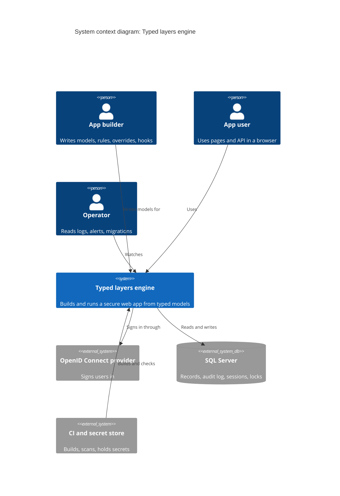
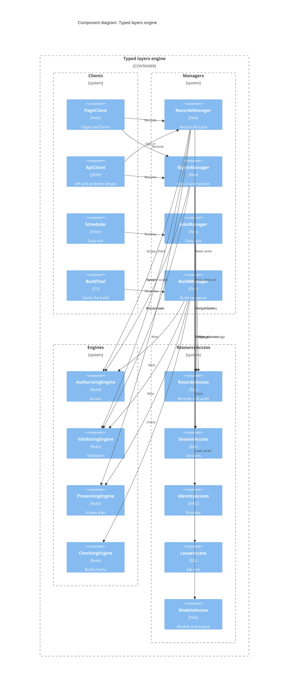

# Typed layers engine: design

Date: 2026-10-18. Source: "Typed Layers Engine and Todo App Spec". Mode: inception (new system, no host code).

## 1. Frame

### Problem

You write typed data models. The engine turns them into a secure web app: access control, storage, validation, screens, and an API. You write code only for exceptions. The todo list app is the first test of the engine.

### Users

- **App builders** write models, access rules, overrides, and hooks.
- **App users** use the pages and the API in a browser.
- **Operators** read logs and alerts, and review migrations.

### Constraints (from the spec)

- F# on .NET. SQL Server. Server-rendered HTML with htmx.
- Sign-in through an external OpenID Connect provider. The API serves only this app's own pages, with the same session.
- The build fails when a default, an access rule, or an override is missing or wrong.
- Every model has one access rule. Deny by default.

### Features

The spec states F1 to F13. F14 is the test app.

| ID | Feature |
| --- | --- |
| F1 | Field behaviour from type and name (override, then type default, then kind default) |
| F2 | Access rules: `owned`, `ownedVia`, `self`, `system`, and read-only when the parent is archived |
| F3 | Storage: schema, derived indexes, keyset paging, child deletes, migrations |
| F4 | Validation: one rule set for forms and API |
| F5 | Screens: lists, forms, list views, edit from the list, History tab |
| F6 | API: paged endpoints, nested routes, `/me`, problem details |
| F7 | Hooks: before save, after save, computed value, delete check |
| F8 | Audit log with masking of `sensitive` fields |
| F9 | Sign-in, sessions, sign-out, and the user record on first sign-in |
| F10 | Security baseline: headers, anti-forgery token, rate limits, size caps |
| F11 | Two daily jobs, each run once across many app copies |
| F12 | Generator, build checks, and migration output |
| F13 | Logs and alerts |
| F14 | Todo app: three models, three access rules, about ten override lines, two hooks |

### System context

Diagram type: C4 system context.

Key: boxes with a person icon are people. "Ext" boxes are outside the engine. Arrows show who starts the call.

### Words used here

- **Model**: a record type, such as `Todo`.
- **Semantic type**: a small type that carries meaning and rules, such as `Title`.
- **Kind**: the basic shape of a type, such as text or date.
- **Override**: a change to one field in one engine.
- **Hook**: hand-written code that acts on a whole record.
- **Volatility**: a thing that is likely to change.
- **Wall**: a component boundary that hides one volatility.
- **Brick**: a small part inside a wall that shares one data shape with the other bricks.
- **Contract**: the data shape that bricks in one wall pass to each other.
- **Manager**: a component that holds a changing sequence of steps.
- **Engine**: a component that holds a changing rule or calculation.
- **ResourceAccess**: a component that hides how a store or a vendor is used.
- **Utility**: a component that any other component may use.
- **Seal**: a value that only one component can make.

## 2. Core use cases

| ID | Core use case | Variations (not core) |
| --- | --- | --- |
| UC1 | Build: turn models into a checked, wired app, or fail | New build check, new migration, `unsafe` list |
| UC2 | Work with a record: create, read, change, delete, or list, as a signed-in user, on a page or in the API | Tick from the list, `/me`, History tab, tags |
| UC3 | Sign in and keep a session | First sign-in, time zone on the welcome page, sign-out, expiry |
| UC4 | Run maintenance jobs once across all app copies | Audit cleanup, session cleanup |

**Nature of the business.** These stay true for the life of the system. No wall goes around them.

- Every model has exactly one access rule. Access is denied by default.
- Field behaviour is chosen in one order: override, type default, kind default.
- Every model gets the system fields `Id`, `Owner`, `Version`, `CreatedAt`, `UpdatedAt`.
- One rule set runs on the server for forms and for the API.
- `Version` catches stale saves.

## 3. Volatility register

| ID | Volatility | Axis | Evidence | Likelihood | Wall |
| --- | --- | --- | --- | --- | --- |
| V1 | Which kinds and semantic types the engines handle | One app over time | "Lists are added later, by the tags test." The change test is in the spec. | High | Rows in each engine, plus `ModelCore` |
| V2 | Access policy | One app over time, and app to app | Out of scope now: "sharing lists, roles beyond owner". Also the read-only condition. | High | `AuthorizingEngine` |
| V3 | Validation rules | One app over time | `rule` override. Type rules differ per type. | High | `ValidatingEngine` |
| V4 | Which control, label, column, and view each field gets | One app over time | Nine display overrides. | High | `PresentingEngine` |
| V5 | How pages are delivered (htmx, server HTML) | App to app | Out of scope: "a separate front end such as a single-page app". | Medium | `PageClient` |
| V6 | Who calls the API, and the wire format | App to app | Out of scope: "API access for other apps, such as a phone app". Spec picks RFC 9457. | Medium | `ApiClient` |
| V7 | Storage: database vendor, indexes, paging, migrations | App to app | Named vendor "SQL Server". Index and paging rules fill a full section. | Medium | `RecordsAccess` |
| V8 | Identity provider | App to app | Named vendor "external OpenID Connect provider". | Medium | `IdentityAccess` |
| V9 | Where sessions live | App to app | "Sessions are stored on the server, in SQL Server." | Medium | `SessionAccess` |
| V10 | The sign-in sequence | One app over time | First sign-in makes the user and asks for a time zone. More steps are likely (for example, a second factor). | Medium | `SignInManager` |
| V11 | The record life-cycle and hook points | One app over time | Four hook points. Audit and child deletes sit in the same flow. | Medium | `RecordsManager` |
| V12 | The list of scheduled jobs | One app over time | "Version 1 has two daily jobs." | High | `JobsManager` |
| V13 | How a job lock works | App to app | "Each job takes a database lock." | Low | `LeaseAccess` |
| V14 | The list of build checks | One app over time | An eight-row check table. Two warning kinds. More are likely. | High | `CheckingEngine` |
| V15 | Where models come from, and the build sequence | One app over time | "The build has two stages." The spec compares four languages. | Low | `ModelsAccess`, `BuildManager` |
| V16 | The web security baseline | One app over time | The OWASP list has a 2025 edition. Headers and limits move. | Medium | `WebGuard` (Utility) |

V15 rests on the spec's own comparison table. Treat it as weak evidence.

### Rejected candidates

| ID | Candidate | Why rejected |
| --- | --- | --- |
| R1 | Retention days, session lifetimes, page sizes, rate limits, alert factor | Variable, not volatile. They are settings in `Settings`. |
| R2 | The todo domain (lists, todos, priorities) | It is the test app. It is not part of the engine. |
| R3 | Soft delete and restore | Out of scope. No evidence. |
| R4 | Real-time updates | Out of scope. No evidence. |
| R5 | Sort and filter beyond named views | Out of scope. The cost is tried in section 6. |
| R6 | The id format (UUID v7) | Stable. It lives in the `id` kind default. |
| R7 | The language (F#) | Decided in the spec. |

## 4. Walls

### Components

| Layer | Component | Hides | Volatility |
| --- | --- | --- | --- |
| Client | `PageClient` | Htmx pages, forms, HTML encoding, welcome-page script | V5 |
| Client | `ApiClient` | JSON routes, wire format, problem details | V6 |
| Client | `Scheduler` | The daily timer | V12 |
| Client | `BuildTool` | The command that CI and builders run | V15 |
| Manager | `RecordsManager` | The steps to create, change, delete, and list a record | V11 |
| Manager | `SignInManager` | The steps to sign in, resume, and sign out | V10 |
| Manager | `JobsManager` | The steps to claim, run, log, and alert for a job | V12 |
| Manager | `BuildManager` | The steps to load, wire, check, and write | V15 |
| Engine | `AuthorizingEngine` | Who may see and change what | V2 |
| Engine | `ValidatingEngine` | What input is accepted | V3 |
| Engine | `PresentingEngine` | Which control, label, column, and view | V4 |
| Engine | `CheckingEngine` | What makes a build fail or warn | V14 |
| ResourceAccess | `RecordsAccess` | SQL Server tables, queries, indexes, migrations, audit log | V7 |
| ResourceAccess | `SessionAccess` | Where sessions live | V9 |
| ResourceAccess | `IdentityAccess` | The OpenID Connect provider | V8 |
| ResourceAccess | `LeaseAccess` | The job lock | V13 |
| ResourceAccess | `ModelsAccess` | Compiled model files, the last shape, generated files | V15 |
| Utility | `Logging`, `Alerting`, `Settings`, `WebGuard`, `Clock` | Shared plumbing | V16 for `WebGuard` |
| Domain module | `ModelCore` | Nothing. It is stable. | n/a |

`ModelCore` is not a component. It holds the stable parts that all walls share: the `Kind` list, `TypeInfo`, `FieldPlan`, `ModelPlan`, `ListSpec`, `Finding`, `Principal`, `FieldErrors`, and the one-time "override, then type, then kind" lookup. It depends on nothing.

### Layer diagram

Diagram type: C4 component diagram. Utilities are left off the arrows. Any component may call them.

Key: each band is one layer. A box calls only the box on the other end of an arrow. All arrows go down.

### APIs (business verbs)

Types are in section 5. `Principal` is the signed-in user.

| Component | Verbs |
| --- | --- |
| `PageClient` | Routes: `GET /{model}`, `GET /{model}/{id}`, `POST /{model}`, `POST /{model}/{id}`, `POST /{model}/{id}/delete`, `GET /{model}/{id}/history`, `GET /me`, `GET /signin`, `GET /signin/callback`, `POST /welcome`, `POST /signout`. Nested: `/lists/{id}/todos`. |
| `ApiClient` | The same routes under `/api`, as JSON. |
| `Scheduler` | `OnDaily` calls `JobsManager.RunDue`. |
| `BuildTool` | `generate` calls `BuildManager.Generate`. |
| `RecordsManager` | `List`, `OpenForm`, `Show`, `Create`, `Change`, `Remove`, `History` |
| `SignInManager` | `BeginSignIn`, `CompleteSignIn`, `FinishWelcome`, `Resume`, `SignOut` |
| `JobsManager` | `RunDue` |
| `BuildManager` | `Generate` |
| `AuthorizingEngine` | `ScopeFor`, `OwnerFor`, `CheckChange`, `Covers`, `Wire` |
| `ValidatingEngine` | `Accept`, `Covers`, `Wire` |
| `PresentingEngine` | `PlanList`, `PlanForm`, `Covers`, `Wire` |
| `CheckingEngine` | `Check` |
| `RecordsAccess` | `Find`, `FindBy`, `FindVisible`, `Page`, `Add`, `Revise`, `Remove`, `HistoryOf`, `ForgetOldHistory`, `PlanStorage`, `Wire` |
| `SessionAccess` | `StartSession`, `ActivateSession`, `ResumeSession`, `EndSession`, `ForgetExpiredSessions` |
| `IdentityAccess` | `BeginSignIn`, `CompleteSignIn`, `EndProviderSession` |
| `LeaseAccess` | `TryClaim`, `Release` |
| `ModelsAccess` | `LoadModels`, `ReadLastShape`, `StoreShape`, `WriteGenerated` |

Notes on the verbs:

- `RecordsAccess` verbs are record verbs because records are this system's business. `Revise` checks `Version`. `Add`, `Revise`, and `Remove` also write the audit entry in the same transaction. That is why there is no separate audit component.
- Every `RecordsAccess` verb takes a `Scope`. Only `AuthorizingEngine` can make a `Scope`. A call with no scope does not compile. This is the "deny by default" rule, enforced by types.
- A record outside the scope is "not found". The Manager returns 404.
- Build-time verbs (`RecordsAccess.PlanStorage` and `Wire`) take the engine-only scope that `AuthorizingEngine` makes.

### Cross-cutting concerns

- **Authorisation:** `AuthorizingEngine`, applied through `Scope` in `RecordsAccess`.
- **Audit:** inside `RecordsAccess`, because it must commit with the change.
- **Atomic writes:** one `RecordsAccess` verb is one transaction. A delete of a parent removes its children, and writes one audit entry for each, in that transaction. Hooks that run "after save" run after the commit.
- **Sensitive fields:** `RecordsAccess` masks them in the audit log. `Logging` drops them.
- **Tenancy:** not needed. There is one app per deployment.

### Size check

There are 4 Clients, 4 Managers, 4 Engines, 5 ResourceAccess, and 5 Utilities. Two numbers sit outside Löwy's range:

- **Engines (4) are not fewer than Managers (4).** The spec splits engine work into separate jobs: access, validation, display, and checks. Each has its own reason to change (V2, V3, V4, V14). `Persist` became a ResourceAccess because it hides a vendor and a store. `API` became a Client because it hides who calls.
- **Four Clients.** The timer and the build command are real callers. Each is tiny.

Managers pass the expendability test. Remove `JobsManager`, and `Scheduler` would call ResourceAccess directly, which breaks the call rules. Remove `BuildManager`, and `BuildTool` would own the sequence, which is the volatility V15.

## 5. Bricks

### Shared contracts

| Contract | Used in | Fields and rules |
| --- | --- | --- |
| `ModelPlan` and `FieldPlan` | Build, all engines | Model name, fields, kind and semantic type of each field, access rule, overrides, hooks. System fields are already added. Additive: a new `Kind` case never breaks old code. |
| `Principal` | Runtime | User id, time zone, session id. Read again on each request, so a changed time zone applies at once. |
| `Scope` | `AuthorizingEngine` to `RecordsAccess` | An owner filter or "engine only". Sealed: no other component can make one. |
| `Candidate` and `FieldErrors` | `ValidatingEngine` | In: raw field text. Out: typed values, or errors listed per field. The form and the API show the same errors. |
| `ScreenPlan` | `PresentingEngine` to `PageClient` | Per field: label, control, limits, editable or not, in list or not. No HTML. |
| `ListSpec` | `PresentingEngine` to `RecordsAccess` | Filter, sort, columns. `Id` is last in the sort. `RecordsAccess` reads this, never the display overrides. |
| `Finding` | `CheckingEngine` | Severity, code, model, field, message. |
| `Session` | `SessionAccess` | Id, user, state, last seen, started at. |

**Mechanism and policy.** The look-up order is stable. It lives in `ModelCore`. The defaults are data tables inside each engine. A new default is a new row, not a new call path.

**Limits as shared data.** `TypeInfo` holds the length and range limits of a type. `ValidatingEngine` enforces them. `PresentingEngine` turns them into `maxlength` and `required`. Neither engine calls the other.

### Bricks by component

Each brick traces to a feature, or to a named volatility. Inputs and Transports at the edges are exempt from the "earn" rule.

**`ValidatingEngine`** (contract: `Candidate` to `FieldErrors`)

| Brick | Kind | Does | Traces to |
| --- | --- | --- | --- |
| `TakeWritable` | Transform | Drops read-only and route-set fields, and every system field except `Version`. `Version` passes on to `Revise`, so stale saves are caught. | F4, F6 |
| `ParseField` | Transform | Raw text to a typed value, through the semantic type | F4, V1 |
| `CheckKind` | Transform | Kind rules (range, decimal places, known case, valid date) | F4, V1 |
| `CheckOverrideRule` | Transform | Runs `rule field predicate message` | V3 |
| `CheckReference` | Transform | Reference exists and is visible. The Manager passes in a `Visible` lookup, so the engine stays pure. | F4, F2 |
| `GatherErrors` | Transform | One `FieldErrors` shape for form and API | F4 |
| `EmitWiring` | Transport | Writes typed code for each model | F12 |

**`AuthorizingEngine`** (contract: `Scope`; each rule brick gives the same three verbs: `ScopeFor`, `OwnerFor`, `CheckChange`)

| Brick | Kind | Does | Traces to |
| --- | --- | --- | --- |
| `Owned` | Transform | Owner is the current user | F2 |
| `OwnedVia` | Transform | Owner is copied from a parent the user can see | F2 |
| `SelfOnly` | Transform | Each record is a user. Only your own. | F2 |
| `SystemOnly` | Transform | No user. Only the engine and hooks. | F2 |
| `ReadOnlyWhenParent` | Transform | Adds a "read-only because ..." decision (409 with reason) | F2 |
| `EmitWiring` | Transport | Writes typed code for each model | F12 |

**`PresentingEngine`** (contract: `ScreenPlan`, `ListSpec`)

| Brick | Kind | Does | Traces to |
| --- | --- | --- | --- |
| `LabelFromName` | Transform | `CompletedAt` becomes "Completed at"; `label` replaces it | F1, F5 |
| `ControlFor` | Transform | Table of control by kind and type | F5, V1, V4 |
| `FormFields` | Transform | Applies `hiddenInForm`, `readOnly`, and the route-set parent | F5 |
| `ListColumns` | Transform | `listColumns`; default is every field that is not wide text | F5 |
| `ListOrder` | Transform | `listSort`; default title; `Id` last | F5 |
| `ListViews` | Transform | `listView` named filters | F5 |
| `ListEdit` | Transform | Which fields can change straight from the list | F5 |
| `TitleOf` | Transform | `titleField`, or the first `TitleType` field | F5, F12 |
| `LimitsToAttributes` | Transform | Type limits to `maxlength` and `required` | F5 |
| `EmitWiring` | Transport | Writes typed code for each model | F12 |

**`CheckingEngine`** (contract: `Finding`). Each check is a Transform that is one row of the spec's check table (V14).

| Brick | Kind | Does |
| --- | --- | --- |
| `MissingDefault` | Transform | A type has no default in an engine. Names the type and each engine. Reads each engine's `Covers`. |
| `MissingAccessRule` | Transform | A model has no rule |
| `MissingField` | Transform | An override names a missing field |
| `WrongConfigType` | Transform | Config does not fit the field type |
| `SystemFieldTarget` | Transform | An override targets a system field |
| `DanglingReference` | Transform | A reference points at a model that does not exist |
| `NoTitleField` | Transform | A referenced model has no title field |
| `UnplannedDrop` | Transform | A migration drops a column with no `renamedFrom` |
| `RedundantOverride` | Transform | Warning: the override equals the default |
| `ListUnsafe` | Transform | Warning: lists each `unsafe` escape hatch with its reason |

**`RecordsAccess`** (contract: `ModelPlan` and `ListSpec` in; typed records out)

| Brick | Kind | Does | Traces to |
| --- | --- | --- | --- |
| `ColumnMap` | Transform | Kind and type to SQL type; `column` and `sensitive` | F3, V7 |
| `QueryBuilder` | Transform | Scope, filter, sort, and cursor to a parameterised query that names its columns | F3, F2 |
| `KeysetCursor` | Transform | Encodes and decodes the page position, with the stored "has value" column | F3 |
| `IndexDeriver` | Transform | Owner, then filters, then sort, then `Id`. Foreign keys too. | F3 |
| `MigrationDiffer` | Transform | Old shape and new shape to a migration. A silent drop is an error. | F3, F12 |
| `RecordTable` | Store | `Find`, `Page`, `Add`, `Revise`, `Remove` (with children), one transaction each | F3 |
| `AuditTrail` | Store | Writes and reads audit entries; `ForgetOldHistory` | F8 |
| `SensitiveMask` | Transform | Masks `sensitive` fields in audit entries | F8 |
| `EmitWiring` | Transport | Writes typed data-access code for each model | F12 |

**`PageClient`**: `RouteTable` (Input, from the models), `FormReader` (Input: form post to `Candidate`, with anti-forgery token and `Version`), `RenderScreen` (Transport: `ScreenPlan` to encoded HTML, with errors beside fields and htmx row swaps), `WelcomeZoneScript` (Input: the browser time zone).

**`ApiClient`**: `RouteTable` (Input), `JsonReader` (Input: JSON to `Candidate`), `WireCodec` (Transform: value to JSON by kind, such as decimal as a string), `ProblemDetails` (Transport: `FieldErrors` and 404, 409 to RFC 9457).

**`RecordsManager`**: `HookRunner` (Transform: runs the four hook kinds with a context of user, time zone, and time). The rest is wiring: the flows in section 6.

**`SignInManager`**: `SessionState` (State machine: `Pending`, `Active`, `Ended`, `Expired`). `SessionAccess` guards each move with a compare-and-set.

**`JobsManager`**: `JobRun` (State machine: `Claimed`, `Running`, `Succeeded`, `Failed`, `Skipped`), `PurgeAudit` (Transform), `PurgeSessions` (Transform). A failed run calls `Alerting`.

**Others:** `Scheduler.OnDaily` (Input). `BuildTool.OnBuild` (Input). `SessionAccess.SessionTable` (Store). `IdentityAccess.OidcExchange` (Input and Transport). `LeaseAccess.Lease` (Store). `ModelsAccess.StageOneLoader` (Input), `ShapeSnapshot` (Store), `SourceWriter` (Transport).

**Count:** 63 bricks across 16 components. `BuildManager` is pure wiring.

### Re-check of the walls

Two hints came up. Both were checked against the register.

- `ValidatingEngine` and `PresentingEngine` both use type limits. Does one volatility hide in both? No. The limits are data in `TypeInfo`. The checks and the HTML attributes change for different reasons.
- `RecordsAccess`, `SessionAccess`, and `LeaseAccess` all use SQL Server. This is a real overlap. See the accepted leak in section 6.

Composition is plain code. No flow is stored as data, because none differs by customer, and none changes faster than a deploy.

## 6. Validation

### 6.1 Use-case walkthrough

Each line is `Caller → Callee.Verb`.

**UC1, Build.** The caller is CI or an app builder. No user signs in. A signed build is the proof of origin.

1. `BuildTool → BuildManager.Generate`
2. `BuildManager → ModelsAccess.LoadModels`
3. `BuildManager → ModelsAccess.ReadLastShape`
4. `BuildManager → PresentingEngine.PlanList` (makes `ListSpec`)
5. `BuildManager → AuthorizingEngine.Wire`, `ValidatingEngine.Wire`, `PresentingEngine.Wire`
6. `BuildManager → RecordsAccess.PlanStorage` (indexes, migration), then `RecordsAccess.Wire`
7. `BuildManager → CheckingEngine.Check` (gets each engine's `Covers` result)
8. `BuildManager → ModelsAccess.WriteGenerated` and `ModelsAccess.StoreShape`, only if there is no error

**UC2, Create a todo on a page.** The caller is a browser. The session cookie says who it is.

1. `PageClient → SignInManager.Resume` (cookie to `Principal`, or "expired")
2. `PageClient → RecordsManager.Create` (after `WebGuard` checks the anti-forgery token)
3. `RecordsManager → RecordsAccess.Find` (the parent list, in scope; 404 if not visible)
4. `RecordsManager → AuthorizingEngine.CheckChange` (409 if the list is archived)
5. `RecordsManager → AuthorizingEngine.OwnerFor`
6. `RecordsManager → ValidatingEngine.Accept` (with a `Visible` lookup bound to `RecordsAccess.FindVisible`)
7. `RecordsManager` runs the before-save hook through `HookRunner`
8. `RecordsManager → RecordsAccess.Add` (insert and audit, one transaction)
9. `RecordsManager` runs the after-save hook after commit; `PageClient` renders the result

The API chain is the same from step 2, with `ApiClient` in place of `PageClient`.

**UC3, Sign in.** The caller is a browser. The provider says who the user is.

1. `PageClient → SignInManager.BeginSignIn`
   `SignInManager → IdentityAccess.BeginSignIn`
2. Provider returns; `PageClient → SignInManager.CompleteSignIn`
3. `SignInManager → IdentityAccess.CompleteSignIn` (identity)
4. `SignInManager → RecordsAccess.FindBy` (the `Subject`, with the engine scope from `AuthorizingEngine.ScopeFor`)
5. User found: `SignInManager → SessionAccess.StartSession` (state `Active`)
6. Not found: `SessionAccess.StartSession` (state `Pending`), then the welcome page posts the time zone
7. `PageClient → SignInManager.FinishWelcome`, then `ValidatingEngine.Accept`, `RecordsAccess.Add`, `SessionAccess.ActivateSession`

**UC4, Daily job.** The caller is a timer.

1. `Scheduler → JobsManager.RunDue`
2. `JobsManager → LeaseAccess.TryClaim` (skip the run if another copy holds it)
3. `JobsManager → RecordsAccess.ForgetOldHistory` and `SessionAccess.ForgetExpiredSessions`
4. `JobsManager → LeaseAccess.Release`; a failed run calls `Alerting`

Result: **4 of 4** walk through with no new component and no broken call rule.

### 6.2 Change simulation

| Change | Components that change | Result |
| --- | --- | --- |
| V1 Add the list kind (tags) | `ModelCore` (one new `Kind` case), plus one new row in `ValidatingEngine`, `PresentingEngine`, `RecordsAccess`, and `ApiClient` | **Accepted leak.** The spec requires it: every engine must define lists. `CheckingEngine` and all Managers stay the same. |
| V1 Add a new semantic type | None. App code only. | Pass |
| V2 Add a "shared with" rule | `AuthorizingEngine` (one rule brick), plus one new `RecordsAccess` verb for the new share fact | Pass (allowed exception) |
| V3 Add a rule | `ValidatingEngine` (one brick), or data in an app override | Pass |
| V4 Add a control | `PresentingEngine` (one row) | Pass |
| V5 Swap htmx for a single-page app | New Client for the new caller | Pass (allowed exception) |
| V6 Add a phone-app API or a new wire format | `ApiClient` | Pass |
| V7 Move from SQL Server to PostgreSQL | `RecordsAccess`, `SessionAccess`, and `LeaseAccess` | **Accepted leak.** One vendor sits behind three components. Each also has its own reason to change (V9, V13). A shared SQL helper would be a Utility; add it when the second port starts. |
| V8 Change the identity provider | `IdentityAccess` | Pass |
| V9 Sessions move to a cache | `SessionAccess` | Pass |
| V10 Add a second sign-in step | `SignInManager` | Pass |
| V11 Add a hook point or a life-cycle step | `RecordsManager` | Pass |
| V12 Add a daily job | `JobsManager` (one brick) | Pass |
| V13 Change the lock method | `LeaseAccess` | Pass |
| V14 Add a build check | `CheckingEngine` (one brick) | Pass |
| V15 Models come from a different source | `ModelsAccess` | Pass |
| V16 New header or limit | `WebGuard` and `Settings` | Pass |

An **allowed exception** is a change that adds a new caller (one new Client) or a new access fact (one rule brick and one new verb). The table marks these as passes.

Result: **15 of 17** rows pass. Two rows are accepted leaks. Each volatility has one main wall, and the two leaks also touch other components.

### 6.3 Feature assembly

Current features as wiring over the bricks. The wiring only picks bricks and passes parameters.

| Feature | Assembled from |
| --- | --- |
| F1 | `ModelCore` look-up over each engine's tables |
| F2 | `AuthorizingEngine` rule bricks, `Scope`, `RecordsAccess.QueryBuilder` |
| F3 | `ColumnMap`, `QueryBuilder`, `KeysetCursor`, `IndexDeriver`, `MigrationDiffer`, `RecordTable` |
| F4 | `TakeWritable`, `ParseField`, `CheckKind`, `CheckOverrideRule`, `CheckReference`, `GatherErrors` |
| F5 | `PresentingEngine` bricks, `PageClient` bricks |
| F6 | `ApiClient` bricks, `RecordsManager` |
| F7 | `HookRunner` inside `RecordsManager` |
| F8 | `AuditTrail`, `SensitiveMask` |
| F9 | `SignInManager`, `SessionState`, `OidcExchange`, `SessionTable` |
| F10 | `WebGuard`, `Settings` |
| F11 | `Scheduler`, `JobRun`, `PurgeAudit`, `PurgeSessions`, `Lease` |
| F12 | `BuildManager`, `CheckingEngine` bricks, `EmitWiring` bricks, `MigrationDiffer` |
| F13 | `Logging`, `Alerting`, `SensitiveMask` |
| F14 | Models, rules, overrides, hooks. **No engine change.** |

Result: **14 of 14** assembled with no new brick.

Future features, each with at most one new brick:

- **Shared lists.** One new rule brick in `AuthorizingEngine` and one new `RecordsAccess` verb for share rows. Nothing else.
- **Email reminders for due todos.** A new daily job in `JobsManager`, and a new `MailAccess` ResourceAccess (one new resource). The hook points already exist.
- **Token sign-in for a phone app.** One new Input brick in `SignInManager.Resume`. `IdentityAccess` already hides the provider.

Rejected candidate, tried for cost: **R5, free sort and filter.** `PresentingEngine`, `RecordsAccess` (`QueryBuilder`, `IndexDeriver`), `ApiClient`, and `PageClient` all change. It is a wide change, which is one more reason to keep it out of scope.

### 6.4 Independence check

For each brick, the question is: if its requirement changed a lot, what else would change?

| Brick | Else that changes | Result |
| --- | --- | --- |
| `CheckKind` | Nothing. | Pass |
| `ControlFor` | Nothing. `LimitsToAttributes` reads `TypeInfo`, not this table. | Pass |
| `QueryBuilder` | Nothing. It reads `ListSpec`. | Pass |
| `IndexDeriver` | Nothing. It reads the same `ListSpec` and the access rule. | Pass |
| `Owned`, `OwnedVia`, `SelfOnly`, `SystemOnly` | Nothing. Each gives the same three verbs. | Pass |
| `WireCodec` | Nothing. | Pass |
| `SessionState` | `SessionTable` if the stored states change. That is the same wall. | Pass |
| `MigrationDiffer` | `UnplannedDrop` reads its output. That is a documented read of a shared `Finding` input, not a hidden link. | Pass |
| `SensitiveMask` | `Logging` has its own filter. If the masking rule changes, both change. | **Hint.** Both read the `sensitive` flag in `FieldPlan`, so the rule is one fact. The two filters stay separate, because one is a store and the other is a Utility. |

### 6.5 Rule and smell audit

| Check | Result |
| --- | --- |
| Calls go down only | Pass. No Manager calls another Manager. No Engine calls another Engine or a ResourceAccess. |
| Clients call only Managers | Pass. `PageClient` and `ApiClient` get `ScreenPlan` and records through `RecordsManager`. |
| Names | Pass. Components are named for what they hide. Clients and Utilities are named for what they are. |
| No CRUD or vendor words in verbs | Pass, with one note: `RecordsAccess` verbs are record verbs by design. `Save`, `Insert`, and `Update` are not used. |
| Sizes | 4, 4, 4, 5, 5. Two points are explained in section 4. |
| Mode flags | None found. |
| Merged bricks | None found. `CheckKind` is one table. If a row needs a flag, split that row. |
| Engines that read stores | None. `ValidatingEngine` gets a lookup function. |

### 6.6 Trace audit

- Each component traces to a volatility: see the table in section 4.
- Each brick traces to a feature or a volatility: see section 5.
- **Cut list:** two items were cut during design. A shared `SqlRunner` Utility, because only the second port needs it. A stored-workflow tool, because no flow differs by customer.

### 6.7 Measured coupling

Not applicable: inception. No git history exists for this system.

## 7. Seam and migration

Not applicable: inception. There is no host system.

## 8. Assumptions and open items

These were decided without asking. `/blueprint` carries them forward.

| ID | Assumption |
| --- | --- |
| A1 | The engine library and the todo test app live in this one repo. The todo app is only a consumer. |
| A2 | The build-time parts (`BuildManager`, `CheckingEngine`, `ModelsAccess`) belong to this system. |
| A3 | `Persist` is a ResourceAccess, not an Engine. `API` is a Client. `Display` splits into `PresentingEngine` and `PageClient`. |
| A4 | The audit log is part of `RecordsAccess`, because it must commit with the change. |
| A5 | Hooks are app code. `RecordsManager` runs them through `HookRunner`. They need no own component. |
| A6 | A pending session holds the identity while the welcome page asks for the time zone. |
| A7 | `Principal` is rebuilt from the user record on each request. |
| A8 | The reference check uses a lookup function that the Manager passes in. |
| A9 | The Utilities are `Logging`, `Alerting`, `Settings`, `WebGuard`, and `Clock`. |
| A10 | The choice of containers and deployment belongs to `/blueprint`. |
| A11 | The read-only reason ("This list is archived") is built from the parent model name and the field name. |

Accepted leaks: **V1** (a new kind touches each engine by design) and **V7** (one database vendor sits behind three ResourceAccess components).

## 9. Next steps

- `/argue` this document, to find contradictions.
- `/blueprint`, to turn it into typed contracts, state machines, signatures, and Gherkin scenarios.
- `/quiz-plan`, to turn the build plan in the spec into an executable change plan.
